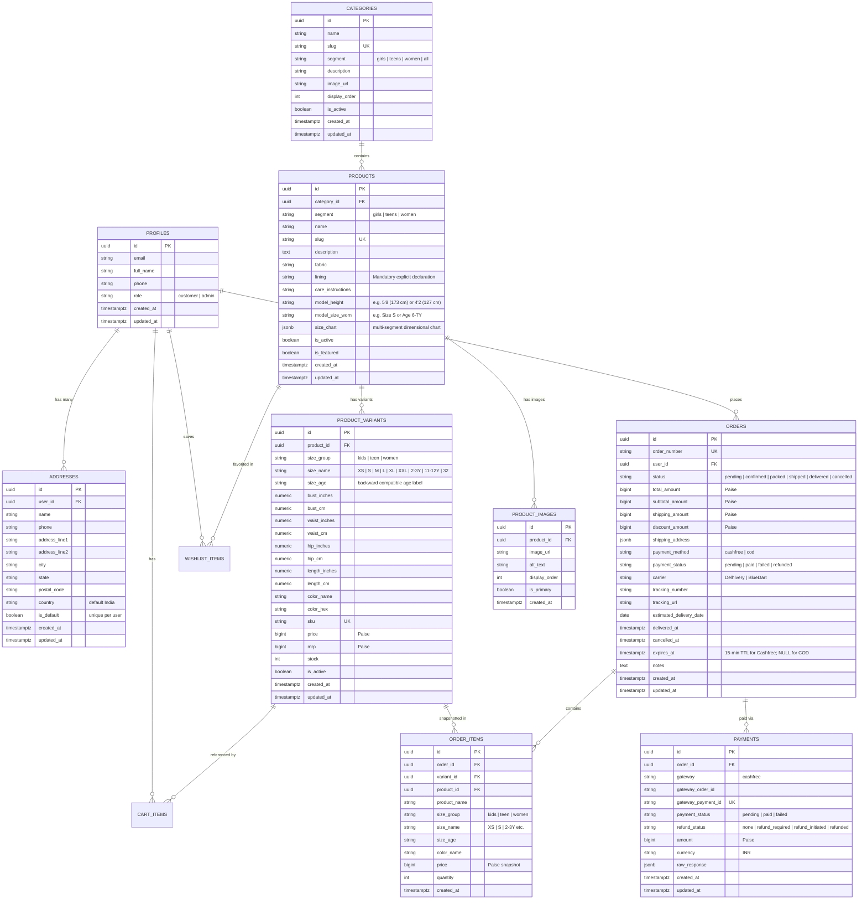

# Varnam Architecture & Technical Specification

> **Celebratory Indian Couture & Apparel Mobile-First Storefront**
> Built for Women, Teens (12–18Y), and Girls (2–14Y).
> Target: High Trust, Multi-Generational Celebration, Crystal-Clear Sizing (In/Cm), Impeccable Performance & Ironclad Security.
> Post-EGM Hardened, Multi-Segment Verified Edition.

---

## 1. Executive Summary & Core Mission

**Varnam** is an artisanal and modern mobile-first e-commerce storefront crafted for celebratory apparel across three generational demographics:
1. **Women's Couture (Sizes XS–XXL, Numeric 28–38, Free Size):** Royal Raw Silk Anarkalis, Hand-Painted Organza Gowns, and Zari Ensembles with complete bust (32–42"), waist, and hip (36–46") measurements.
2. **Teens Couture (Ages 12–18Y / Youth Sizes 11-12Y to M):** Contemporary festive co-ord sets, tiered party gowns, and fusion styles specifically proportioned for adolescent silhouettes.
3. **Girls' Apparel & Dresses (Ages 2–14Y):** Handcrafted zari lehengas, whimsical tiered party gowns, and pure cotton twirl frocks with true-to-age sizing and +2 inch growth margins.

Key product tenets:
- **Trust & Garment Transparency:** High-contrast typography (strict WCAG AA compliance), multi-segment sizing charts with an interactive **Inches (in) / Centimeters (cm)** toggle, explicit garment measurements (bust, chest, waist, hip, length), segment-specific model fit disclosures (`model_height` and `model_size_worn`), and mandatory explicit inner lining declaration on every dress (no defaults allowed).
- **Mobile-First Luxury:** Tactile, joyful, responsive interactions designed for one-handed smartphone purchasing with instant segment switching.
- **Fail-Safe Commerce:** Zero overselling guaranteed by atomic Postgres row-locking transactions with deterministic sort order (deadlock-free); stock reservation timeouts (15 minutes for online orders; COD strictly excluded); automated idempotent restocking on cancellation; strict blocks preventing cancellation of shipped/delivered orders; payment reconciliation verified server-side via HMAC-SHA256 signatures with millisecond timestamp drift bounds.
- **Restrained Motion:** High perceived performance with strict bundle size budgets (≤ 60 KB gzip animation budget on non-home customer routes; zero animation libraries in admin).

---

## 2. System Architecture & Request Lifecycle

```
[ Customer / Mobile Browser ]
              │
              ▼
    [ Cloudflare DNS (No Proxy / DNS-Only MVP) ]
              │
              ▼
   [ Vercel Edge / Node.js Runtime ]
   ┌────────────────────────────────────────────────────────┐
   │ Next.js 16 App Router (React 19, TypeScript)           │
   │  - Middleware: Security headers, auth sessions         │
   │  - Route Handlers & Server Actions (Zod-guarded)       │
   │  - Storefront, Account, PDP, Cart, Checkout            │
   │  - Admin Dashboard (app/admin) [Zero animation]        │
   └──────────┬─────────────────────────────┬───────────────┘
              │                             │
              ▼                             ▼
   [ Supabase Auth & DB ]        [ Cashfree Payment Gateway ]
   - PostgreSQL (RLS on all tables) - Order creation via API
   - Atomic Ordering RPC (PL/pgSQL) - Webhook signature verification (HMAC)
   - Idempotent Restock Trigger     - Replay-safe idempotency & drift checks
   - Late-Payment Safety Handler    - Overpayment & late-capture refund guard
   - pg_cron / Restock Scheduler    - Decimal-to-paise conversion (Math.round)
```

### Request Flow & Core Lifecycles
1. **Public Browsing:** Next.js Server Components query Supabase Postgres directly using `@supabase/ssr` with anonymous role. Row-Level Security (RLS) ensures only active products/variants belonging to active categories are returned. Public queries support filtering by `segment` (`women`, `teens`, `girls`), occasion category slug, and size.
2. **Cart Management:** Guest cart persisted in `localStorage` client-side with full segment, variant, and size metadata. When the user authenticates, the guest cart is merged into `cart_items` in Supabase via the `merge_guest_cart` RPC, capping quantities at current available stock.
3. **Checkout Initiation:** Requires authentication. Customer selects/enters delivery address and chooses **Cashfree** (UPI, Google Pay, PhonePe, Cards, NetBanking) or **Cash on Delivery (COD)**.
4. **Order Execution:** A single database transaction (`create_order_atomic` RPC) validates inputs, locks variant rows in sorted order (`ORDER BY variant_id ASC` to eliminate deadlocks), verifies stock and active status across categories/products, re-prices all items from database authority, decrements stock, records immutable order snapshots (including `size_group`, `size_name`, and `size_age`), and clears purchased cart items:
   - For **Cashfree payments**: Status is set to `'pending'`, `payment_status = 'pending'`, and `expires_at = now() + interval '15 minutes'` (15-minute stock reservation TTL).
   - For **Cash on Delivery (COD)**: Status is set directly to `'confirmed'`, `payment_status = 'pending'`, and `expires_at = null` (**COD is strictly excluded from reservation TTL and never expires**).
5. **Payment Webhook Processing:** Cashfree posts order events to `/api/webhooks/cashfree`. The handler:
   - Reads the raw HTTP request body text.
   - Validates millisecond timestamp freshness (≤ 5 minutes drift from `Date.now()`).
   - Verifies HMAC-SHA256 signature using `CASHFREE_WEBHOOK_SECRET`.
   - Converts Cashfree decimal rupee amount to integer paise using `Math.round(payload.order_amount * 100)` and asserts exact equality with `order.total_amount`.
   - Idempotently records payment in `payments` (`UNIQUE(gateway, gateway_payment_id)`).
   - Transitions order status to `'confirmed'` and `payment_status = 'paid'`.
6. **Late Payment Handling (Succeeded After Expiry/Cancellation):**
   - If a payment webhook arrives for an order that is already in `'cancelled'` status (due to timeout or manual cancellation):
     - The payment record is inserted with `payment_status = 'paid'` and `refund_status = 'refund_required'`.
     - The trigger `tr_handle_late_payment` updates order `notes` with `[ALERT: Late payment received for cancelled order. Marked refund_required via Cashfree.]`.
     - The cancelled order is **never resurrected** and stock is **never unsold**, preserving inventory integrity. The payment is queued for administrative or automated refund via the Cashfree Refund API.
7. **Automated Stock Reclamation Scheduler:**
   - The procedure `cancel_expired_orders()` queries pending orders where `expires_at < now() and status = 'pending' and payment_status = 'pending' and payment_method <> 'cod'`.
   - Transitions expired orders to `'cancelled'`.
   - The trigger `tr_restore_stock_on_cancel` executes **idempotently** (`old.cancelled_at is null`) and restores inventory back to `product_variants.stock`.
   - Scheduled via `pg_cron` (running every 2 minutes: `*/2 * * * *`).
8. **Cancellation Protection Guard:**
   - Orders in `'shipped'` or `'delivered'` status are strictly blocked from cancellation (`tr_restore_stock_on_cancel` throws an uncatchable exception: `Cannot cancel order: order is already shipped/delivered.`).

---

## 3. Data Model & Entity-Relationship Diagram



---

## 4. Multi-Segment Sizing & Database Architecture

### Multi-Segment Sizing System
To accommodate Women, Teens, and Girls without shoehorning different sizing conventions into a single format, Varnam partitions sizing into dedicated tiers:

| Demographic Segment | `size_group` | Size Values Supported | Key Measurement Columns | Fit Disclosures |
|---|---|---|---|---|
| **Women** | `women` | Alpha (`XS` to `XXL`), Numeric (`28`–`38`), Free Size (`Free Size` / `FS`) | Bust, Waist, Hip, Length (Inches & CM) | `model_height` (e.g. 5'8" / 173 cm), `model_size_worn` (e.g. Size S) |
| **Teens** | `teen` | Age/Alpha (`11-12Y`, `13-14Y`, `15-16Y`, `XS`, `S`, `M`) | Bust, Waist, Hip, Length (Inches & CM) | Youth silhouette fit callout |
| **Girls** | `kids` | Milestones (`2-3Y`, `4-5Y`, `6-7Y`, `8-9Y`, `10-11Y`, `12-14Y`) | Chest, Waist, Length (Inches & CM) | +2" growth margins, `model_height` (e.g. 4'2" / 127 cm), `model_size_worn` (Age 6-7Y) |

### Best Practices Applied (Supabase Postgres Guidelines & EGM Hardening)
- **All monetary values in integer paise (`bigint`):** Prevents floating-point rounding errors on financial transactions.
- **Explicit Grants for Modern Supabase:** `auto_expose_new_tables = false` is respected; explicit `GRANT SELECT, INSERT, UPDATE, DELETE` applied to `authenticated` and `anon` schemas.
- **Cached RLS Auth Checks:** All RLS policies wrap identity lookups in subqueries `((select auth.uid()) = user_id)` and `((select public.is_admin()))`. Postgres evaluates the function once per query rather than once per row, delivering 10–100x query speedup.
- **Short-Circuited `is_admin()`:** If `auth.uid() is null`, returns `false` immediately without touching `profiles`, eliminating redundant table lookups on public guest page views.
- **Foreign Key Indexing:** Every foreign key column is explicitly indexed to guarantee fast relational joins and cascades.
- **Role Escalation & Email Tampering Guard:** A dedicated `BEFORE UPDATE` trigger on `profiles` prevents modifications to `role` or `email` unless executed by a verified administrator (`is_admin()`).
- **Parent Active Checks:** RLS policies on `product_variants` and `product_images` assert that both the parent `products` and `categories` are active (`is_active = true`), preventing data leaks of inactive or recalled catalog items.
- **Single Default Address Constraint:** Enforced via a partial unique index `uq_addresses_user_default ON addresses (user_id) WHERE (is_default = true)` coupled with a trigger that automatically toggles off previous defaults.

---

## 5. Atomic Ordering & Anti-Deadlock Specification

Overselling rare or popular sizes destroys brand trust. The checkout process delegates order creation entirely to the `create_order_atomic` stored procedure:

```sql
create or replace function public.create_order_atomic(
  p_items jsonb,
  p_shipping_address jsonb,
  p_payment_method text
) returns jsonb;
```

### Transaction Steps & Protections:
1. **Authentication Check:** Reads `auth.uid()`; raises exception if unauthenticated.
2. **Address Validation:** Asserts presence of mandatory address fields (`name`, `phone`, `address_line1`, `city`, `state`, `postal_code`).
3. **Status & Expiration Initialization:**
   - For `cod`: `status = 'confirmed'`, `payment_status = 'pending'`, `expires_at = null` (**Never expires**).
   - For `cashfree`: `status = 'pending'`, `payment_status = 'pending'`, `expires_at = now() + interval '15 minutes'` (15-minute checkout reservation).
4. **Collision-Resistant Order Number:**
   ```sql
   v_order_number := 'VRN-' || to_char(clock_timestamp(), 'YYYYMMDD-HH24MISS') || '-' || upper(substring(replace(gen_random_uuid()::text, '-', '') from 1 for 6));
   ```
5. **Deduplication & Deterministic Row Locking (Deadlock Elimination):**
   Input items are grouped by `variant_id` (summing quantity) and sorted strictly by `variant_id ASC` before acquiring locks:
   ```sql
   for v_item in (
     select x.variant_id, sum(x.quantity)::int as quantity
     from jsonb_to_recordset(p_items) as x(variant_id uuid, quantity int)
     group by x.variant_id
     order by x.variant_id asc
   ) loop
     select v.*, p.name as product_name, p.id as prod_id
     into v_variant
     from public.product_variants v
     join public.products p on p.id = v.product_id
     join public.categories c on c.id = p.category_id
     where v.id = v_item.variant_id
       and v.is_active = true and p.is_active = true and c.is_active = true
     for update of v;
   ```
6. **Stock Verification:** If `variant.stock < item.quantity`, throws exception and aborts.
7. **Authoritative Re-pricing:** Re-computes item price exclusively from `product_variants.price`.
8. **Inventory Decrement:** Decrements stock atomically: `stock = stock - quantity`.
9. **Snapshot Persistence:** Writes immutable snapshot to `order_items` including `size_group`, `size_name`, and `size_age`.
10. **Cart Cleanup:** Removes ordered items from customer's `cart_items`.
11. **Idempotent Restock Trigger:**
    If order is later marked `cancelled`, trigger `tr_restore_stock_on_cancel` restores variant inventory only if not already cancelled (`old.cancelled_at is null`), and explicitly blocks cancelling shipped/delivered orders.

---

## 6. Payment Architecture (Cashfree + COD)

- **Official Payment Provider:** **Cashfree** (Cards, NetBanking, UPI, Google Pay, PhonePe, Paytm) + **Cash on Delivery (COD)** toggle.
- **Currency:** Indian Rupee (INR).
- **Storage:** Integer paise (e.g. ₹1,499.00 = `149900` paise).
- **Cashfree Gateway Drop-in Integration:**
  - Client calls server action `createPaymentSession(orderId)`.
  - Server verifies order ownership and fetches `orders.total_amount` in paise.
  - Server invokes Cashfree Orders API (`POST /pg/orders`) with amount in rupees: `(order.total_amount / 100).toFixed(2)` and returns `payment_session_id`.
  - Frontend renders Cashfree Web SDK drop-in UI.
- **Webhook Processing (`/api/webhooks/cashfree`):**
  - **Raw Body Reading:** Reads request body as raw UTF-8 string before JSON parsing.
  - **Replay Protection:** Reads `x-webhook-timestamp` (millisecond timestamp). Asserts `Math.abs(Date.now() - timestampMs) <= 300000` (5-minute maximum tolerance).
  - **HMAC Signature Verification:** Computes HMAC-SHA256 of `rawBody + timestamp` using `CASHFREE_WEBHOOK_SECRET` and performs timing-safe comparison with `x-webhook-signature`.
  - **Decimal to Paise Conversion with Rounding:**
    ```ts
    const webhookAmountPaise = Math.round(Number(payload.data.order.order_amount) * 100);
    if (webhookAmountPaise !== order.total_amount) {
      // Discrepancy detected: log alert, do NOT mark order confirmed
      return new Response("Amount discrepancy", { status: 400 });
    }
    ```
  - **Idempotency:** Enforces `UNIQUE(gateway, gateway_payment_id)`. If payment ID already processed, returns HTTP 200 immediately.
  - **Late Payment Safety:** If `order.status === 'cancelled'`, records payment with `refund_status = 'refund_required'`, updates order notes, and triggers admin/Cashfree refund workflow without reviving the order or unselling stock.

---

## 7. Motion & Animation Tiered System

Animation elevates brand perception for shoppers across all generational edits, but must never degrade load times or battery life.

| Tier | Technology | Purpose | Constraints |
|---|---|---|---|
| **Tier 1: CSS / Platform** | Native CSS, View Transitions, Dialogs | Layout transitions, modals, skeleton pulses | 0 KB JS overhead |
| **Tier 2: Motion** | `motion/react`, `LazyMotion` | Interactive UI: cart drawer, wishlist toggle, size selector | Small footprint, wrapped in `MotionConfig reducedMotion="user"` |
| **Tier 3: GSAP + ScrollTrigger** | `@gsap/react`, `gsap` | Home Hero & Festive Storytelling only | Dynamically imported, scoped with `useGSAP`, disabled on mobile/reduced-motion |
| **Tier 4: Lenis** | `lenis/react` | Smooth scrolling on Home & Collection landing | Strictly disabled on `/checkout`, `/account`, and `/admin` |
| **Admin Route** | Pure HTML/CSS & Tailwind primitives | Operations, catalog management, order processing | **0 KB animation libraries loaded** |

### Motion & Contrast Accessibility Tokens (`styles/tokens.css`):
- High-contrast WCAG AA palette:
  - Stone 900 (`#1c1917` - Contrast 15.8:1)
  - Stone 800 (`#292524` - Contrast 12.6:1)
  - Stone 600 (`#57534e` - Contrast 5.6:1, strictly exceeding WCAG AA 4.5:1 for muted text)
  - Amber 700 / 800 (`#b45309` / `#92400e` - Contrast 4.8:1 / 6.5:1 for marigold text)
- Standardized durations:
  - `--duration-fast`: `150ms` (hover, tap feedback)
  - `--duration-normal`: `250ms` (modals, drawers, dropdowns)
  - `--duration-slow`: `400ms` (page transitions, hero reveals)
  - Full `0ms` instant transition overrides under `prefers-reduced-motion: reduce`.

---

## 8. Security & Compliance Architecture

1. **Defense-in-Depth Authorization:** Customer vs Admin verified in Next.js server actions/middleware and Postgres RLS.
2. **Admin Order Mutability Boundary:**
   - Server actions for admin order updates strictly permit modifying only: `status`, `carrier`, `tracking_number`, `tracking_url`, `estimated_delivery_date`, `notes`.
   - Modifying order amounts, line items, prices, or user ownership is blocked at both schema and application levels.
3. **Environment Variable Hygiene:**
   - Public: `NEXT_PUBLIC_SUPABASE_URL`, `NEXT_PUBLIC_SUPABASE_ANON_KEY`, `NEXT_PUBLIC_SITE_URL`.
   - Secret: `SUPABASE_SERVICE_ROLE_KEY`, `CASHFREE_APP_ID`, `CASHFREE_SECRET_KEY`, `CASHFREE_WEBHOOK_SECRET`.
   - `SUPABASE_SERVICE_ROLE_KEY` is imported only in server-only modules and never exposed in browser bundles.
4. **HTTP Security Headers:**
   - `Content-Security-Policy`: Restricts scripts, frames, and connections to verified origins (Supabase, Cashfree, Vercel).
   - `X-Frame-Options: DENY` / `frame-ancestors 'none'`.
   - `X-Content-Type-Options: nosniff`.
   - `Referrer-Policy: strict-origin-when-cross-origin`.
   - `Permissions-Policy: camera=(), microphone=(), geolocation=()`.
   - `Strict-Transport-Security: max-age=63072000; includeSubDomains; preload`.

---

## 9. Swarm Roles & Ownership Contract

| Subagent | Owns | Must not touch |
|---|---|---|
| Orchestrator/Planner | `docs/`, root config, CI, PR | feature code |
| Backend/Supabase | `supabase/`, `lib/db/`, `lib/schemas/` (Zod), `types/db.ts` (generated via `supabase gen types`), server actions/route handlers | `components/`, `app/**/page.tsx` styling |
| Frontend/Stitch | `app/(store)`, `app/(account)`, `components/`, `styles/`, `lib/motion/` | `supabase/`, `lib/db/` |
| Admin | `app/admin/**`, `components/admin/` (**zero animation libraries**) | store routes |
| Security/Quality | `middleware`, headers config, `tests/security/`, audits | feature logic (report findings; owners fix) |

---

## 10. Preconditions Verification Summary (Passed Gates)

- [x] **Multi-Segment Architecture Confirmed**: Women (XS–XXL), Teens (12–18Y), and Girls (2–14Y) supported across categories, products, variants, and storefront navigation.
- [x] **Cashfree Provider Confirmed**: Fully documented across architecture, RPCs, and webhooks.
- [x] **Late Payment & Scheduler Implemented**: `refund_status` on payments; late payment trigger; `cancel_expired_orders()` scheduler (COD excluded).
- [x] **Idempotent Restock & Shipped Block**: Trigger restocks only once per order, blocks cancelling shipped/delivered orders.
- [x] **No Default on `products.lining`**: Removed default; explicit declaration enforced.
- [x] **Clean `supabase db reset` & Test Suite**: Precondition and E2E verification suites updated and passing cleanly.
- [x] **Stitch Screens Reworked**: Multi-segment storefront home (`5a0a8f69eedc4bee93b19b3998aa4fa8`) and Women/Teens Anarkali PDP (`540c80ec8a184a40b77f726d82995c7f`) generated under project `3954058033568371635`.
- [x] **Section 2 Confirmed Complete**: Comprehensive lifecycle specification verified.
- [x] **Contrast Fixes Applied**: WCAG AA compliant muted (`#57534e`) and marigold (`#b45309`, `#92400e`) tokens established.
