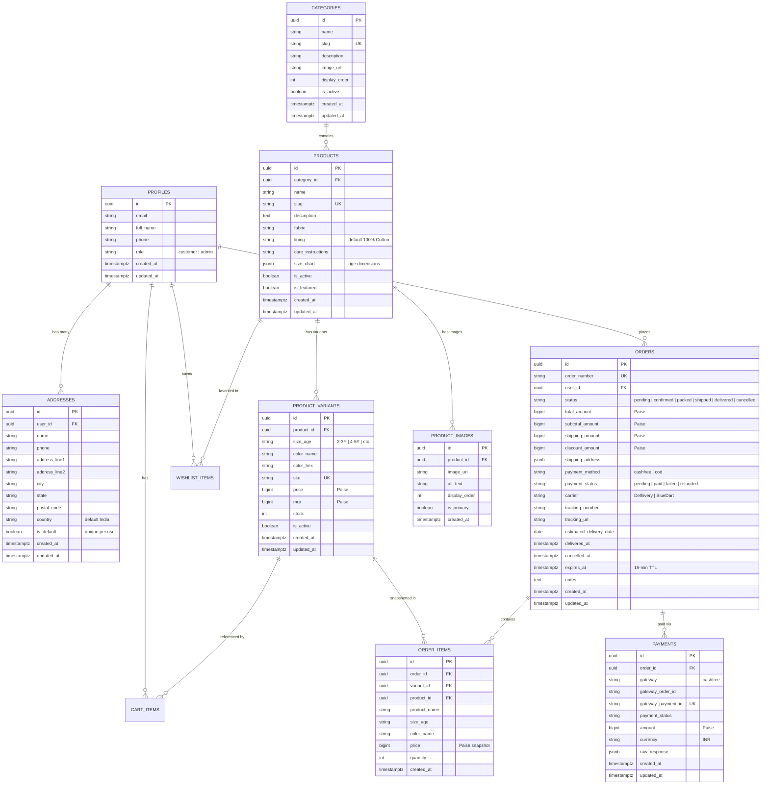

# Varnam Architecture & Technical Specification

> **Girls' Dress & Apparel Mobile-First Storefront**
> Built for Parents Buying for Girls Aged 2–14.
> Target: High Trust, Joyful Celebration, Crystal-Clear Sizing, Impeccable Performance & Ironclad Security.
> Post-EGM Review Hardened Edition.

---

## 1. Executive Summary & Core Mission

**Varnam** is an artisanal and modern e-commerce storefront crafted for parents purchasing premium dresses, festive lehengas, gowns, frocks, and casual apparel for girls aged 2 to 14. 

Key product tenets:
- **Parent-Centric Trust & Transparency:** High contrast typography, clear age-based sizing (2–3Y, 4–5Y, 6–7Y, 8–9Y, 10–11Y, 12–14Y), explicit garment measurements (chest, waist, length in inches/cm), and detailed fabric, inner lining, and care disclosures.
- **Mobile-First Luxury:** Tactile, joyful, responsive interactions designed for one-handed smartphone purchasing.
- **Fail-Safe Commerce:** Zero overselling guaranteed by atomic Postgres row-locking transactions with deterministic sort order (deadlock-free); stock reservation timeouts (15 minutes); automated restocking on cancellation; payment reconciliation verified server-side via HMAC-SHA256 signatures with timestamp drift bounds.
- **Restrained Motion:** High perceived performance with strict bundle size budgets (≤ 60 KB gzip animation budget on non-home customer routes; zero animation libraries in admin).

---

## 2. System Architecture & Request Lifecycle

```
[ Customer / Mobile Browser ]
              │
              ▼
    [ Cloudflare DNS (No Proxy / DNS-Only MVP) ]
              │
              ▼
   [ Vercel Edge / Node.js Runtime ]
   ┌──────────────────────────────────────────────────┐
   │ Next.js 16 App Router (React 19, TypeScript)     │
   │  - Middleware: Security headers, auth sessions   │
   │  - Route Handlers & Server Actions (Zod-guarded) │
   │  - Storefront, Account, PDP, Cart, Checkout      │
   │  - Admin Dashboard (app/admin) [Zero animation]  │
   └──────────┬─────────────────────────────┬─────────┘
              │                             │
              ▼                             ▼
   [ Supabase Auth & DB ]        [ Cashfree Payment Gateway ]
   - PostgreSQL (RLS on all tables) - Order creation via API
   - Atomic Ordering RPC (PL/pgSQL) - Webhook signature verification
   - Restock Trigger on Cancel      - Replay-safe idempotency
   - Supabase Storage (product-images)- Overpayment/tamper checks
```

### Request Flow
1. **Public Browsing:** Next.js Server Components query Supabase Postgres directly using `@supabase/ssr` with anonymous role. Row-Level Security (RLS) ensures only active products/variants belonging to active categories are returned.
2. **Cart Management:** Guest cart persisted in `localStorage` client-side. When the user authenticates, the guest cart is merged into `cart_items` in Supabase via the `merge_guest_cart` RPC, capping quantities at current available stock.
3. **Checkout Initiation:** Requires authentication. Customer selects/enters delivery address and chooses Cashfree (UPI/Cards) or Cash on Delivery (COD).
4. **Order Execution:** A single database transaction (`create_order_atomic` RPC) validates inputs, locks variant rows in sorted order (`ORDER BY variant_id ASC` to eliminate deadlocks), verifies stock and active status across categories/products, re-prices all items from database authority, decrements stock, records immutable order snapshots, and clears purchased cart items. For Cashfree orders, a 15-minute `expires_at` reservation is set. For COD, status is set to `confirmed`.
5. **Payment Webhook:** Cashfree posts order events to `/api/webhooks/cashfree`. The server validates timestamp freshness (≤ 5 min drift), verifies HMAC-SHA256 signature against raw request body, asserts `webhook.amount * 100 == order.total_amount`, and idempotently transitions order/payment status.
6. **Stock Reclamation:** If an unpaid Cashfree order exceeds 15 minutes, the `cancel_expired_orders()` worker transitions it to `cancelled`, and the `tr_restore_stock_on_cancel` trigger automatically restores inventory to `product_variants`.

---

## 3. Data Model & Entity-Relationship Diagram



---

## 4. Database & RLS Architecture

### Best Practices Applied (Supabase Postgres Guidelines & EGM Hardening)
- **All monetary values in integer paise (`bigint`):** Prevents floating-point rounding errors on financial transactions.
- **Cached RLS Auth Checks:** All RLS policies wrap identity lookups in subqueries `((select auth.uid()) = user_id)` and `((select public.is_admin()))`. Postgres evaluates the function once per query rather than once per row, delivering 10–100x query speedup.
- **Short-Circuited `is_admin()`:** If `auth.uid() is null`, returns `false` immediately without touching `profiles`, eliminating redundant table lookups on public guest page views.
- **Foreign Key Indexing:** Every foreign key column is explicitly indexed to guarantee fast relational joins and cascades.
- **Role Escalation & Email Tampering Guard:** A dedicated `BEFORE UPDATE` trigger on `profiles` prevents modifications to `role` or `email` unless executed by a verified administrator (`is_admin()`).
- **Parent Active Checks:** RLS policies on `product_variants` and `product_images` assert that both the parent `products` and `categories` are active (`is_active = true`), preventing data leaks of inactive or recalled catalog items.
- **Single Default Address Constraint:** Enforced via a partial unique index `uq_addresses_user_default ON addresses (user_id) WHERE (is_default = true)` coupled with a trigger that automatically toggles off previous defaults.

---

## 5. Atomic Ordering & Anti-Deadlock Specification

Overselling rare or popular sizes destroys brand trust. The checkout process delegates order creation entirely to the `create_order_atomic` stored procedure:

```sql
create or replace function public.create_order_atomic(
  p_items jsonb,
  p_shipping_address jsonb,
  p_payment_method text
) returns jsonb;
```

### Transaction Steps & Protections:
1. **Authentication Check:** Reads `auth.uid()`; raises exception if unauthenticated.
2. **Address Validation:** Asserts presence of mandatory address fields (`name`, `phone`, `address_line1`, `city`, `state`, `postal_code`).
3. **Status & Expiration Initialization:**
   - For `cod`: `status = 'confirmed'`, `payment_status = 'pending'`, `expires_at = null`.
   - For `cashfree`: `status = 'pending'`, `payment_status = 'pending'`, `expires_at = now() + interval '15 minutes'`.
4. **Collision-Resistant Order Number:**
   ```sql
   v_order_number := 'VRN-' || to_char(clock_timestamp(), 'YYYYMMDD-HH24MISS') || '-' || upper(substring(replace(gen_random_uuid()::text, '-', '') from 1 for 6));
   ```
5. **Deduplication & Deterministic Row Locking (Deadlock Elimination):**
   Input items are grouped by `variant_id` (summing quantity) and sorted strictly by `variant_id ASC` before acquiring locks:
   ```sql
   for v_item in (
     select x.variant_id, sum(x.quantity)::int as quantity
     from jsonb_to_recordset(p_items) as x(variant_id uuid, quantity int)
     group by x.variant_id
     order by x.variant_id asc
   ) loop
     select v.*, p.name as product_name, p.id as prod_id
     into v_variant
     from public.product_variants v
     join public.products p on p.id = v.product_id
     join public.categories c on c.id = p.category_id
     where v.id = v_item.variant_id
       and v.is_active = true and p.is_active = true and c.is_active = true
     for update of v;
   ```
6. **Stock Verification:** If `variant.stock < item.quantity`, throws exception and aborts.
7. **Authoritative Re-pricing:** Re-computes item price exclusively from `product_variants.price`.
8. **Inventory Decrement:** Decrements stock atomically: `stock = stock - quantity`.
9. **Snapshot Persistence:** Writes immutable snapshot to `order_items`.
10. **Cart Cleanup:** Removes ordered items from customer's `cart_items`.
11. **Automatic Restock Trigger:**
    If order is later marked `cancelled`, trigger `tr_restore_stock_on_cancel` automatically restores all variant inventory.

---

## 6. Payment Architecture (Cashfree + COD)

- **Currency:** Indian Rupee (INR).
- **Storage:** Integer paise (e.g. ₹1,499.00 = `149900` paise).
- **Payment Modes:**
  - `cashfree`: Initiates Cashfree PG session on order creation, returns `payment_session_id`. Customer completes UPI/Card flow in Cashfree drop-in UI.
  - `cod`: Cash on Delivery toggle. Directly confirms order.
- **Webhook Processing (`/api/webhooks/cashfree`):**
  - Reads raw request text body before JSON parsing.
  - **Replay Protection:** Rejects payloads with timestamp drift > 5 minutes (`Math.abs(Date.now() - timestampMs) > 300000`).
  - **HMAC Signature Check:** Computes HMAC-SHA256 of `rawBody + timestamp` using `CASHFREE_WEBHOOK_SECRET` and compares with `x-webhook-signature`.
  - **Amount Verification:** Asserts `paymentPayload.order_amount * 100 === order.total_amount`. Rejects discrepancies.
  - **Idempotency:** Table `payments` enforces `UNIQUE(gateway, gateway_payment_id)`. If payment ID already processed, responds with HTTP 200 immediately.
  - **Status Transition:** Updates `orders.payment_status = 'paid'` and `orders.status = 'confirmed'` only if order is in `pending` status. If already cancelled, records payment for administrative refund candidate.

---

## 7. Motion & Animation Tiered System

Animation elevates brand perception for parents shopping for celebratory wear, but must never degrade load times or battery life.

| Tier | Technology | Purpose | Constraints |
|---|---|---|---|
| **Tier 1: CSS / Platform** | Native CSS, View Transitions, Dialogs | Layout transitions, modals, skeleton pulses | 0 KB JS overhead |
| **Tier 2: Motion** | `motion/react`, `LazyMotion` | Interactive UI: cart drawer, wishlist toggle, size selector | Small footprint, wrapped in `MotionConfig reducedMotion="user"` |
| **Tier 3: GSAP + ScrollTrigger** | `@gsap/react`, `gsap` | Home Hero & Festive Storytelling only | Dynamically imported, scoped with `useGSAP`, disabled on mobile/reduced-motion |
| **Tier 4: Lenis** | `lenis/react` | Smooth scrolling on Home & Collection landing | Strictly disabled on `/checkout`, `/account`, and `/admin` |
| **Admin Route** | Pure HTML/CSS & Tailwind primitives | Operations, catalog management, order processing | **0 KB animation libraries loaded** |

### Motion Tokens (`styles/tokens.css`):
- `--duration-fast`: `150ms` (hover, tap feedback)
- `--duration-normal`: `250ms` (modals, drawers, dropdowns)
- `--duration-slow`: `400ms` (page transitions, hero reveals)
- `--ease-standard`: `cubic-bezier(0.2, 0, 0, 1)`
- `--ease-out`: `cubic-bezier(0, 0, 0.2, 1)`
- `--ease-spring`: `cubic-bezier(0.34, 1.56, 0.64, 1)`
- Reduced Motion override: all durations set to `0ms` when `prefers-reduced-motion: reduce`.

### Critical Performance Guardrails:
- **LCP Protection:** The LCP hero image is prioritized with `priority` / `fetchpriority="high"`, uses `next/image`, and is never animated or delayed.
- **Budget:** Animation libraries contribute ≤ 60 KB gzip to non-home customer routes.
- **ESLint Restriction:** ESLint rule prevents importing `gsap` outside `app/(store)/(home)` or marketing components.

---

## 8. Security & Compliance Architecture

1. **Defense-in-Depth Authorization:** Customer vs Admin verified in Next.js server actions/middleware and Postgres RLS.
2. **Environment Variable Hygiene:**
   - Public: `NEXT_PUBLIC_SUPABASE_URL`, `NEXT_PUBLIC_SUPABASE_ANON_KEY`, `NEXT_PUBLIC_SITE_URL`.
   - Secret: `SUPABASE_SERVICE_ROLE_KEY`, `CASHFREE_APP_ID`, `CASHFREE_SECRET_KEY`, `CASHFREE_WEBHOOK_SECRET`.
   - `SUPABASE_SERVICE_ROLE_KEY` is imported only in server-only modules and never exposed in browser bundles.
3. **HTTP Security Headers:**
   - `Content-Security-Policy`: Restricts scripts, frames, and connections to verified origins (Supabase, Cashfree, Vercel).
   - `X-Frame-Options: DENY` / `frame-ancestors 'none'`.
   - `X-Content-Type-Options: nosniff`.
   - `Referrer-Policy: strict-origin-when-cross-origin`.
   - `Permissions-Policy: camera=(), microphone=(), geolocation=()`.
   - `Strict-Transport-Security: max-age=63072000; includeSubDomains; preload`.
4. **Input Sanitization & Validation:** All user submissions (addresses, cart operations, variant creation) pass through strict Zod schemas before database queries.

---

## 9. Swarm Roles & Ownership Contract

| Subagent | Owns | Must not touch |
|---|---|---|
| Orchestrator/Planner | `docs/`, root config, CI, PR | feature code |
| Backend/Supabase | `supabase/`, `lib/db/`, `lib/schemas/` (Zod), `types/db.ts` (generated via `supabase gen types`), server actions/route handlers | `components/`, `app/**/page.tsx` styling |
| Frontend/Stitch | `app/(store)`, `app/(account)`, `components/`, `styles/`, `lib/motion/` | `supabase/`, `lib/db/` |
| Admin | `app/admin/**`, `components/admin/` (**zero animation libraries**) | store routes |
| Security/Quality | `middleware`, headers config, `tests/security/`, audits | feature logic (report findings; owners fix) |

**Handoff Contract:** Backend publishes generated DB types and shared Zod schemas first. Frontend consumes them and does not hand-write DB types.

---

## 10. EGM Review Findings & Resolution Matrix

| ID | Origin | Finding | Resolution Applied |
|---|---|---|---|
| **1.1** | Hostile Critic / Tech Lead | Unsorted variant locking in `create_order_atomic` causes deadlocks under concurrent checkout. | Added deduplication and deterministic sorting `ORDER BY variant_id ASC` before row lock acquisition. |
| **2.1** | Hostile Critic / Tech Lead | Asymmetric inventory drain (DoI attack): stock decremented on pending order creation with no restock on cancel/timeout. | Added `expires_at` (15-min TTL) on orders, `tr_restore_stock_on_cancel` trigger to restock cancelled orders, and `cancel_expired_orders()` RPC. |
| **3.1** | Hostile Critic | Inactive product/category bypass in atomic ordering and variant RLS. | `create_order_atomic` joins `products` and `categories` asserting `is_active = true`. Updated variant RLS to verify parent active states. |
| **4.1** | Hostile Critic / Tech Lead | Webhook double-crediting race due to missing unique constraint on `payments`. | Added `uq_payments_gateway_payment unique (gateway, gateway_payment_id)` and indexed `gateway_order_id`. |
| **4.2** | Hostile Critic | Webhook replay attacks, missing timestamp drift bounds, and amount tampering. | Webhook spec mandates ≤ 5 min timestamp drift check, raw text HMAC signature check, amount verification (`amount * 100 == total_amount`), and status guards. |
| **4.3** | Hostile Critic / Tech Lead | COD orders permanently trapped in `pending` status. | `create_order_atomic` conditionally sets `status = 'confirmed'` for COD. |
| **5.1** | Hostile Critic | Non-idempotent storage policies crashing migrations on re-run. | Added `drop policy if exists` guards and restricted admin uploads to `/products/*`. |
| **5.2** | Hostile Critic | Unvalidated JSONB shipping address. | Added validation inside `create_order_atomic` requiring `name`, `phone`, `address_line1`, `city`, `state`, `postal_code`. |
| **6.1** | Tech Lead | Missing carrier, tracking URL, and delivery date on `orders`. | Added `carrier`, `tracking_url`, `estimated_delivery_date`, `delivered_at`, `cancelled_at` to `orders`. |
| **6.2** | Tech Lead | Missing garment inner lining and size chart dimensions on `products`. | Added `lining text not null default '100% Breathable Cotton'` and `size_chart jsonb` to `products`. |
| **7.1** | Tech Lead | Undefined guest cart merge protocol. | Created dedicated `merge_guest_cart(p_items jsonb)` RPC with stock-capping rules. |
| **8.1** | Tech Lead / Hostile Critic | Multiple default addresses allowed per customer. | Added partial unique index `uq_addresses_user_default` and auto-clearing trigger `handle_address_default`. |
| **9.1** | Tech Lead | Incomplete motion tokens in `styles/tokens.css`. | Added canonical `--duration-*` and `--ease-*` tokens with 0ms fallbacks under `prefers-reduced-motion`. |
| **1.2** | Hostile Critic | 6-char order number collision under volume. | Expanded entropy: microsecond timestamp + random alphanumeric substring. |
| **3.2** | Hostile Critic | `is_admin()` scans `profiles` on every public guest request. | Added `auth.uid() is null` short-circuit in `is_admin()`. |
| **3.3** | Hostile Critic | User able to modify `profiles.email` to spoof identity. | Guarded `email` modification in `prevent_profile_tampering` trigger. |

---

## 11. Definition of Done Checklist

- [ ] `tsc --noEmit`, `eslint`, and `next build` pass cleanly.
- [ ] Playwright e2e test suite:
  - Browse → filter by age/category → PDP → add to bag → guest merge → checkout (Cashfree & COD) → order confirmation.
  - Admin login → order status update (pending → confirmed → packed → shipped → delivered).
  - Admin product creation with variants, pricing, and image upload.
- [ ] RLS verification test suite:
  - Customer A cannot read or write Customer B's cart, wishlist, addresses, or orders.
  - Self role escalation denied.
  - Profile email spoofing denied.
  - Unauthenticated guests can view only active products belonging to active categories.
- [ ] Concurrency test:
  - Two simultaneous checkout requests for the last remaining unit of an SKU: exactly one succeeds; the other is rejected with insufficient stock; no deadlocks.
- [ ] `pnpm audit` and secret scan report zero critical/high vulnerabilities.
- [ ] Lighthouse mobile audit: ≥ 90 on Performance, Accessibility, and SEO on Home, Listing, and PDP.
- [ ] Reduced-motion behavior verified across all animated elements.
- [ ] Animation bundle size verified: ≤ 60 KB gzip on non-home customer routes; 0 KB in admin.
