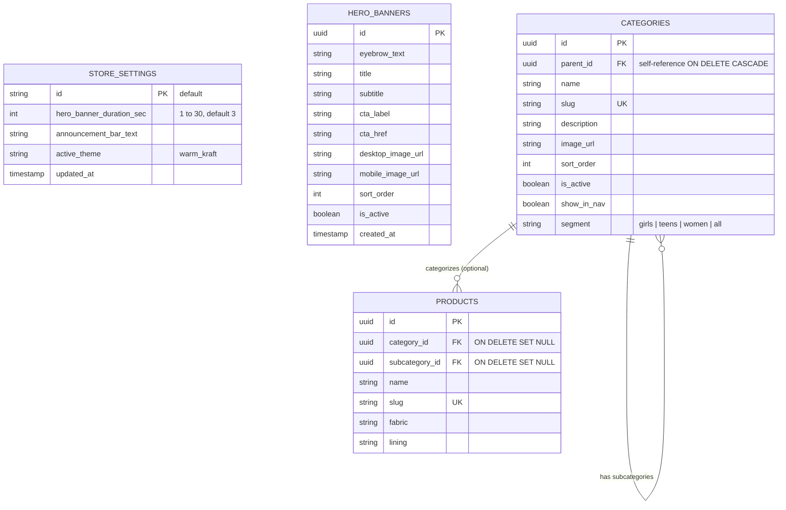
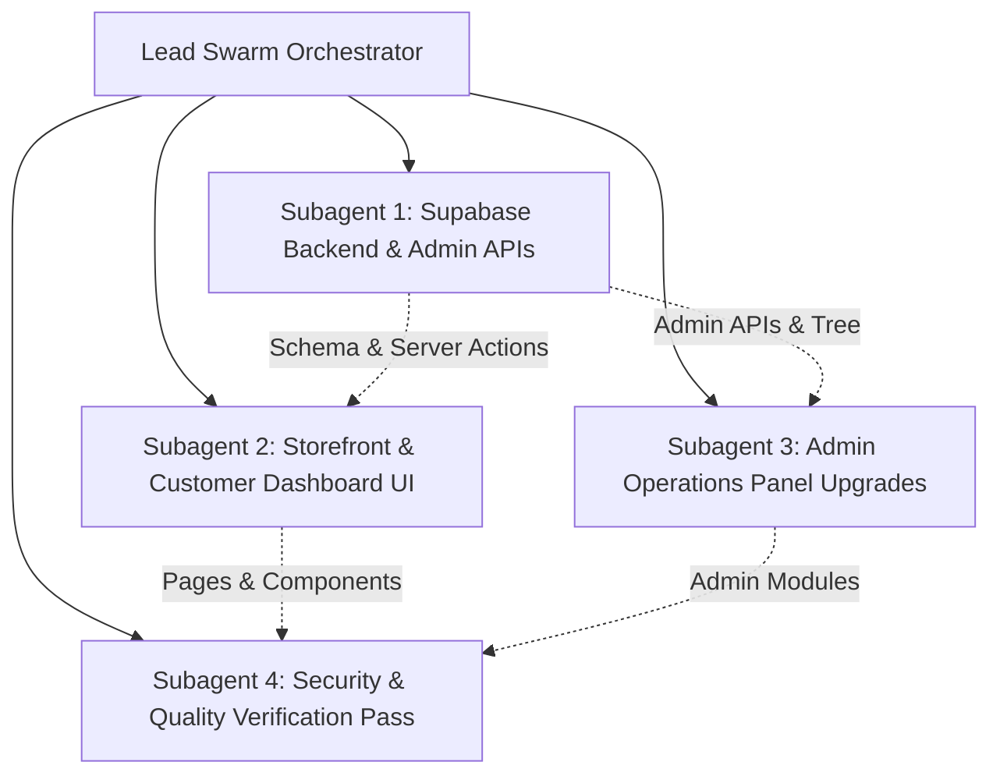

# Varnam Frontend Redesign & Dynamic Architecture Proposal
**Methodology:** Elephant-Goldfish Model (EGM) Task-Planning & Structured Context Architecture  
**Target Date:** November 2026  
**Status:** Approved for Direct Execution (Phase 2 Swarm)  
**Theme:** Warm Kraft-Cardboard & Festive Indian Luxury  

---

## 1. Executive Summary & Problem Formulation

### 1.1 Context & Objectives
Varnam is an artisanal Indian couture and celebratory clothing brand catering to Girls (ages 2–12Y), Teens (13–18Y), and Women (XS–XXL). While the existing database schema, atomic order concurrency, and Cashfree webhook mechanisms are production-hardened, the current storefront UI requires a comprehensive redesign into an authentic, tactile **Warm Kraft-Cardboard & Festive Indian Luxury** visual language.

Furthermore, business operations require:
1. **Admin-Controlled Rotating Hero Banners:** Configurable rotation duration (default 3 seconds, adjustable between 1–30 seconds via admin UI), rich metadata (eyebrow, title, subtitle, CTA label, CTA link, desktop and mobile image URLs, active toggle, sort order), and live pause-on-hover.
2. **100% Dynamic Storefront Navigation Subheadings & Clothing-Type Dropdowns:** Dynamic hierarchy in `categories` (parent subheadings such as *Pattu & Lehengas*, *Anarkali & Shararas*, *Mulmul & Festive Frocks* with child clothing types). Admins can add, rename, reorder, toggle, or delete subheadings and clothing types with zero hardcoding.
3. **Foreign-Key Deletion Safety:** Deleting a category or subheading in Admin must **never crash or orphan** products (`ON DELETE SET NULL`), and deleted categories must disappear cleanly from navigation and catalog views.
4. **Preservation of Existing Backend Contracts & Verification Pass:** All atomic RPCs, guest-to-customer cart syncing, Cashfree webhook security, RLS policies, and Playwright/precondition test assertions must continue to pass with 100% fidelity.

---

## 2. Frontend Wipe & Replacement Manifest

Every storefront, customer dashboard, authentication, and shared UI component is slated for complete rewrite to eliminate legacy CSS variables and styling.

### 2.1 Complete Replacement Inventory
| File Path | Action | Description & New Scope |
|---|---|---|
| `app/globals.css` | **Full Rewrite** | Modern Kraft & Festive CSS variables, Tailwind 4 theme tokens, clean typography bindings. |
| `styles/tokens.css` | **Full Rewrite** | Exact design tokens: `#EFE6D5` (Canvas), `#FAF5EB` (Cards), `#3B281E` (Chestnut Header/Footer), `#8B1E3F` (Kumkum Crimson), `#C69214` (Gold/Zari), `#145349` (Peacock Emerald), `#261C17` (Espresso Charcoal). |
| `components/header.tsx` | **Full Rewrite** | Sticky `#3B281E` header, woven Marigold Toran garland SVG along bottom edge, Namaste welcome ribbon, dynamic Admin-controlled subheadings with interactive dropdown menus, search bar, cart drawer counter, and account link. |
| `components/footer.tsx` | **Full Rewrite** | Roasted Chestnut footer with artisanal kraft embellishments, trust badges, policy links, newsletter, and craft certifications. |
| `components/banner-carousel.tsx` | **Full Rewrite** | Dynamic banner carousel fetching active `hero_banners` with admin-configured duration (`hero_banner_duration_sec`), smooth transitions, pause-on-hover, prev/next navigation, slide indicators, and festive Subhamasthu framing. |
| `components/product-card.tsx` | **Full Rewrite** | Handloom Ivory Cardstock (`#FAF5EB`) with `1px solid #D8C7AE`, tactile shadow, Boutique Hang-Tag styling, weave/fabric tag, age chips, ₹ INR price + MRP + % OFF, Quick Add with cart sync, and Quick View trigger. |
| `components/quick-view-modal.tsx` | **Full Rewrite** | Interactive modal for rapid dress inspection, size selection, fabric & lining transparency, and instant bag addition. |
| `components/size-guide-modal.tsx` | **Full Rewrite** | Couture measurement table with 1-Inch Inner Growth Seam Allowance explanation, interactive In/Cm toggle (with `.bg-brand-primary` indicator for test compliance). |
| `components/catalog-browser.tsx` | **Full Rewrite** | Multi-attribute filtering (demographic segment, age milestones 1–16Y, price, weave, fabric, and occasion), sorting, and responsive grid layout. |
| `components/home-hero-motion.tsx` | **Full Rewrite** | Lightweight entrance and transition wrappers respecting `prefers-reduced-motion`. |
| `components/motion-provider.tsx` | **Full Rewrite** | Clean client wrapper for motion hydration without hydration mismatches. |
| `components/pdp-client.tsx` | **Full Rewrite** | Multi-angle image gallery, age/size selector chips with live stock badges, quantity stepper (`- 1 +`), 1-inch growth allowance badge, Add to Bag with guest/DB sync, and Gift Note option. |
| `components/smooth-scroll.tsx` | **Full Rewrite** | Lightweight smooth-scroll wrapper utilizing Lenis for luxury feel while disabling on reduced-motion. |
| `app/(store)/layout.tsx` | **Full Rewrite** | Shared storefront layout with Marigold Toran header, announcement ribbon, and festive footer. |
| `app/(store)/page.tsx` | **Full Rewrite** | Homepage featuring Dynamic Admin Hero Banner Carousel, Shop by Daughter's Age quick-bar (`1-2 Yrs` to `15-16 Yrs`), Shared Occasion Collections, Curated Boutique Hang-Tag Cards, and Craft Trust Badges. |
| `app/(store)/collections/page.tsx` | **Full Rewrite** | Unified catalog supporting `segment` filtering (`women`, `teens`, `girls`) with exact H1 headers matching test specs. |
| `app/(store)/collections/[category]/page.tsx` | **Full Rewrite** | Dynamic category and clothing-type collection page querying active dresses linked to that category or child subcategory. |
| `app/(store)/products/[slug]/page.tsx` | **Full Rewrite** | Rich PDP with fabric transparency, explicit malmal cotton lining disclosure, model fit, size chart modal, and related dresses. |
| `app/(store)/cart/page.tsx` | **Full Rewrite** | Shopping Bag with Handwritten Kraft Gift Card message input, free shipping progress bar, promo code engine, and checkout link. |
| `app/(store)/checkout/page.tsx` | **Full Rewrite** | Secure checkout supporting 10-digit Indian phone validation (`[6-9][0-9]{9}`), saved addresses, Cashfree online payment, and Cash on Delivery (COD). |
| `app/(store)/orders/[orderNumber]/page.tsx` | **Full Rewrite** | Order status page with 5-step courier tracker, printable GST invoice button, and guest-access protection. |
| `app/(store)/orders/[orderNumber]/confirmation/page.tsx` | **Full Rewrite** | Celebratory thank-you page with festive motifs and order summary. |
| `app/(store)/privacy/page.tsx`, `returns/page.tsx`, `shipping/page.tsx`, `terms/page.tsx` | **Full Rewrite** | Kraft-styled legal and customer care policy pages. |
| `app/(auth)/login/page.tsx` & `signup/page.tsx` | **Full Rewrite** | Warm cardstock authentication cards with role-preserving login and redirect support. |
| `app/(account)/layout.tsx` | **Full Rewrite** | Customer account dashboard navigation (Orders, Fit Profile, Addresses, Wishlist). |
| `app/(account)/account/page.tsx` | **Full Rewrite** | "My Varnam Wardrobe" summary, Saved Daughter's Fit Profile (1-click age filter), recent orders overview. |
| `app/(account)/account/orders/page.tsx` | **Full Rewrite** | Detailed order history with courier tracking numbers (AWB), invoice downloads, and 7-day size exchange drawer. |
| `app/(account)/account/addresses/page.tsx` | **Full Rewrite** | Saved Indian delivery addresses with pincode and state validation. |
| `app/(account)/account/wishlist/page.tsx` | **Full Rewrite** | Customer wishlist with 1-click "Move to Bag" integration. |
| `app/admin/layout.tsx` | **Full Rewrite** | Warm Kraft & Roasted Chestnut operational admin layout with links to Banners, Categories, Products, and Orders. |
| `app/admin/banners/page.tsx` | **New Page** | Dedicated Admin Hero Banner & Timer manager (slider/input for slide duration, banner upload, CRUD, active toggle). |
| `app/admin/categories/page.tsx` | **New Page** | Dedicated Admin Navigation Subheadings & Clothing Types manager (visual tree/card editor, inline rename, add, reorder, delete with safety confirmation). |
| `app/admin/products/page.tsx` | **Enhanced** | Inventory listing with category tags and stock overview. |
| `app/admin/products/new/page.tsx` | **Enhanced** | Dynamic category and clothing-type selectors, auto-generated measurement drafts, `#confirmDraft` checkbox, and safe saving. |
| `app/admin/orders/page.tsx` | **Enhanced** | Order fulfillment with carrier selection and AWB tracking updates. |

---

## 3. Database Schema Extensions (Supabase Migration)

New migration: `supabase/migrations/20261120000003_store_settings_banners_and_dynamic_categories.sql`



### 3.1 `store_settings` Table Specification
```sql
create table if not exists public.store_settings (
  id text primary key check (id = 'default'),
  hero_banner_duration_sec integer not null default 3 check (hero_banner_duration_sec between 1 and 30),
  announcement_bar_text text default '✨ Festive Special: Free Shipping across India on prepaid orders above ₹1,499 | Handcrafted with 1-inch inner growth seam allowance',
  active_theme text not null default 'warm_kraft',
  created_at timestamptz not null default now(),
  updated_at timestamptz not null default now()
);

-- Singleton seed
insert into public.store_settings (id, hero_banner_duration_sec, active_theme)
values ('default', 3, 'warm_kraft')
on conflict (id) do nothing;
```

### 3.2 `hero_banners` Table Specification
```sql
create table if not exists public.hero_banners (
  id uuid primary key default gen_random_uuid(),
  eyebrow_text text,
  title text not null,
  subtitle text,
  cta_label text not null default 'Explore Collection',
  cta_href text not null default '/collections',
  desktop_image_url text not null,
  mobile_image_url text,
  sort_order integer not null default 0,
  is_active boolean not null default true,
  created_at timestamptz not null default now(),
  updated_at timestamptz not null default now()
);

-- Storage bucket for admin banners
insert into storage.buckets (id, name, public)
values ('banners', 'banners', true)
on conflict (id) do nothing;
```

### 3.3 Dynamic Categories & Foreign-Key Safety Specification
```sql
-- Add hierarchy and navigation flags to categories
alter table public.categories
  add column if not exists parent_id uuid references public.categories(id) on delete cascade,
  add column if not exists sort_order integer not null default 0,
  add column if not exists show_in_nav boolean not null default true;

-- Loosen products foreign key to allow ON DELETE SET NULL
alter table public.products alter column category_id drop not null;
alter table public.products drop constraint if exists products_category_id_fkey;
alter table public.products
  add constraint products_category_id_fkey
  foreign key (category_id) references public.categories(id) on delete set null;

alter table public.products
  add column if not exists subcategory_id uuid references public.categories(id) on delete set null;
```

### 3.4 Initial Seed Data: 3 Primary Storefront Subheadings & Child Types
1. **Pattu & Lehengas** (`pattu-lehengas`, `sort_order = 1`):
   - *Pattu Pavadai* (`pattu-pavadai`)
   - *Velvet & Brocade Lehengas* (`velvet-brocade-lehengas`)
   - *Handloom Kanchi Tissue Sets* (`handloom-kanchi-tissue-sets`)
2. **Anarkali & Shararas** (`anarkali-shararas`, `sort_order = 2`):
   - *Floor-Length Silk Anarkalis* (`floor-length-silk-anarkalis`)
   - *Twirl Flare Sharara Suits* (`twirl-flare-sharara-suits`)
   - *Angrakha Peplum Sets* (`angrakha-peplum-sets`)
3. **Mulmul & Festive Frocks** (`mulmul-festive-frocks`, `sort_order = 3`):
   - *Tiered Festive Cotton Frocks* (`tiered-festive-cotton-frocks`)
   - *Embroidered Yoke Twirl Dresses* (`embroidered-yoke-twirl-dresses`)
   - *Zari-Trimmed Organza Frocks* (`zari-trimmed-organza-frocks`)

---

## 4. Subagent Swarm Ownership Matrix

To ensure maximum concurrency with **zero merge conflicts and zero file overlap**, work is partitioned across 4 specialized roles:



### 4.1 Strict File Partitioning
| Subagent | Exclusive File Scope | Deliverables & Responsibilities |
|---|---|---|
| **Subagent 1: Backend & DB** | `supabase/migrations/20261120000003_*.sql`<br>`lib/db/actions.ts`<br>`lib/db/fallback-data.ts`<br>`lib/schemas/index.ts` | 1. Database migration with `store_settings`, `hero_banners`, `categories` hierarchy, and FK safety.<br>2. Validated Server Actions for banners, rotation timer, and navigation tree (`getNavigationTree`, `upsertCategoryNode`, `deleteCategoryNode`, `reorderCategoryNodes`, `getHeroBanners`, `updateBannerDuration`).<br>3. Resilient `getProducts()` handling null category gracefully without crashing. |
| **Subagent 2: Storefront & Customer UI** | `app/globals.css`<br>`styles/tokens.css`<br>`components/*`<br>`app/(store)/*`<br>`app/(account)/*`<br>`app/(auth)/*` | 1. Complete Warm Kraft-Cardboard (`#EFE6D5`) & Festive Luxury design system implementation.<br>2. Sticky `#3B281E` header with Marigold Toran SVG garland & dynamic subheadings dropdown.<br>3. Dynamic auto-rotating hero carousel with admin timer (default 3s).<br>4. Boutique Hang-Tag product cards, PDP with 1-inch seam allowance modal, Bag/Checkout with Kraft gift card note and 10-digit phone validation.<br>5. "My Varnam Wardrobe" dashboard with Daughter's fit profile, 5-step courier tracker, printable GST invoice, and 7-day exchange drawer. |
| **Subagent 3: Admin Operations UI** | `app/admin/layout.tsx`<br>`app/admin/banners/page.tsx`<br>`app/admin/categories/page.tsx`<br>`app/admin/products/page.tsx`<br>`app/admin/products/new/page.tsx`<br>`app/admin/products/[id]/page.tsx`<br>`app/admin/actions.ts` | 1. Matching Warm Kraft & Roasted Chestnut theme for `/admin`.<br>2. Dedicated `/admin/banners` manager with slide duration slider/input (default 3s) and banner CRUD.<br>3. Dedicated `/admin/categories` tree editor with inline rename, add subheading, add clothing type, reorder, and safe deletion.<br>4. Dynamic Category & Subcategory selectors in Product Form. |
| **Subagent 4: Security & Quality Verification** | `tests/unit-banners-categories.test.ts`<br>`tests/preconditions.test.ts`<br>`tests/integration-e2e.test.ts`<br>`tests/webhook.test.ts`<br>Repository CI & Git push | 1. Audit RLS on new tables (`store_settings`, `hero_banners`, `categories`).<br>2. Comprehensive verification suite testing rotation timer bounds, category tree mutations, and deletion safety.<br>3. Complete `tsc --noEmit`, `pnpm lint`, all test passes, and `pnpm build` verification.<br>4. Clean commit and push to `origin/main`. |

---

## 5. Verification Invariants & Non-Negotiable Acceptance Criteria

1. **Test Continuity:** `pnpm exec tsx tests/preconditions.test.ts`, `pnpm exec tsx tests/integration-e2e.test.ts`, and `pnpm exec tsx tests/webhook.test.ts` must pass with zero regressions.
2. **Selector Invariants:**
   - Storefront header retains `header` containing `/Varnam/i`.
   - Collections page retains `/collections` ("All Couture & Dresses"), `/collections?segment=women` ("Women's Couture"), `/collections?segment=teens` ("Teens Couture"), `/collections?segment=girls` ("Girls' Apparel & Dresses").
   - PDP retains "Aashna Royal Crimson", "100% Breathable Malmal Cotton", "Pure Varanasi Raw Silk", "5'8\" (173 cm)", Size Guide button, modal with "Couture Size Chart", "Garment Dimensions", and "Centimeters" toggle with class `bg-brand-primary`.
   - Cart retains "Shopping Bag" and "Explore Collections" link.
   - Checkout retains "Secure Checkout", "Cash on Delivery", and "Place Cash on Delivery Order" redirecting to `/orders/VRN-...`.
   - Admin retains "Operational Dashboard", "Paid Revenue", "Total Orders", "Catalog & Inventory Management", "Add New Dress", `#confirmDraft`, and "Save Product & Variants".
3. **Zero Build & Lint Errors:** `pnpm exec tsc --noEmit` and `pnpm lint` must pass with 0 errors and 0 warnings.
4. **Clean Git State:** All changes committed and pushed to `origin/main`.
